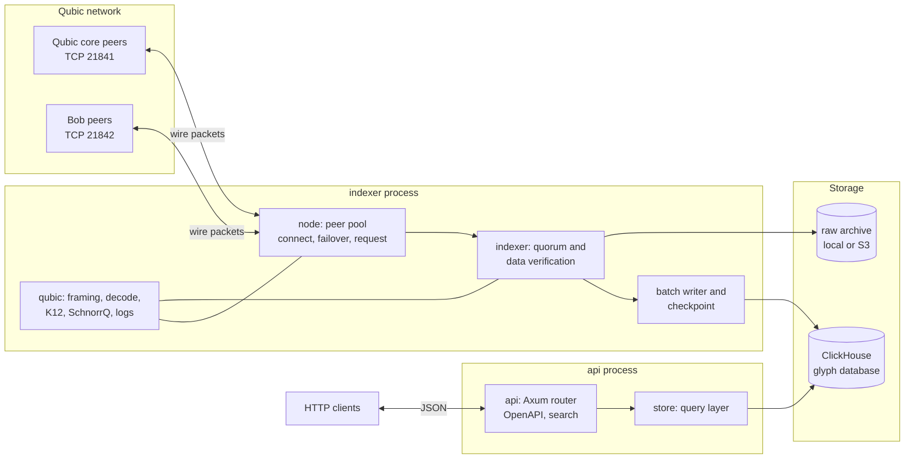

# Architecture

This document describes the target architecture of Glyph API.
It covers the boundaries of the system, the decisions that shape it, and the operational
model. Some robustness features described here are still roadmap work; the implemented
surface is tracked in [ROADMAP.md](./ROADMAP.md) and [README](../README.md). Protocol
details live in [PROTOCOL.md](./PROTOCOL.md), the HTTP contract lives in
[API.md](./API.md), and storage lives in [DATA_MODEL.md](./DATA_MODEL.md).

## Goals

1. Index the live Qubic chain from direct peer connections, with no hosted RPC in the
   runtime path.
2. Start at the epoch that is current on first run and move forward. No backfill before
   that epoch and no compatibility layer for core-bob or the official RPC.
3. Produce a resource-oriented HTTP API that is easier to consume than peer responses:
   stable identifiers, typed events, cursor pagination, RFC 9457 errors, OpenAPI, and
   identity and search lookups.
4. Keep verification explicit. Every stored tick carries the evidence tier that was
   reached before it was published.
5. Keep the ingest path and the query path independently deployable and independently
   scalable. A slow API must not stall verification. A burst of ticks must not make the
   API unresponsive.

## Non-goals

- Historical backfill before the epoch present at first start.
- Wallet functionality, signing, or transaction submission.
- Consensus participation. Glyph API verifies votes, it does not vote.
- Serving as a general purpose Qubic core replacement.
- Compatibility shims for the official RPC schema or core-bob endpoints.
- Cross-chain indexing or price oracles beyond what Qubic logs contain.

## Why direct peers

A hosted RPC is an availability and correctness dependency that we do not control. Qubic
peers expose the same wire protocol used by the network, including quorum votes, per-tick
log ranges, and raw log bodies. That data is what verification needs.

Direct peer access gives us:

- **No third-party rate limit or outage in the read path.** A peer restart is handled by
  pooling and retry, not by a vendor incident.
- **Vote and log access.** A hosted summary API may not expose the vote set needed to
  prove quorum, and may normalize events before we can verify digests.
- **Independent verification.** We decode the wire format and check K12, SchnorrQ, and
  quorum immediately. We do not inherit another indexer's interpretation.
- **Predictable cost.** Peer bandwidth replaces per-request API billing.

The tradeoffs are real:

- Peers are operated by unknown parties. They can be slow, stale, or malicious. We need
  multiple peers, signature checks, and quorum thresholds.
- Peer discovery is our problem. We use configured seeds and `ExchangePublicPeers`.
- There is no SLA. The indexer must fail closed and resume from a checkpoint instead of
  assuming a stable upstream.
- The wire format has sharp edges. The protocol document records them.

## Options considered

| Option | Benefits | Costs | Decision |
| --- | --- | --- | --- |
| Hosted RPC only | Fast start, simple HTTP client | Rate limits, no votes or raw logs, hidden normalization, availability dependency | Rejected |
| Direct peer TCP only | Full data, independent verification, no vendor | Peer churn, custom transport, no SLA | Chosen |
| Direct peer TCP plus hosted RPC fallback | Extra availability | Reintroduces the dependency and a second data model | Rejected |
| Single process doing ingest and API | Fewer moving parts | Query load fights ingest, restarts take the API down, memory coupling | Rejected for production |
| Split ingest and API sharing ClickHouse | Isolation, independent scale, one source of truth | Two binaries, shared schema contract, eventual consistency at the head | Chosen |
| Pull ticks by number | Ordered, gap detectable, replayable | One round trip per artifact per tick | Chosen |
| Rely on broadcast ticks and transactions | Lower latency | Unordered, lossy, not sufficient for completeness | Rejected as source of truth. Used only as a hint |
| ClickHouse as primary store | Columnar scans, compression, projections, cheap epoch drops | No transactions, eventual dedup, limited point-update semantics | Chosen |
| PostgreSQL as primary store | Transactions, constraints, strong point lookups | Expensive full-chain scans, weaker compression | Rejected |
| Embedded KV store | Simple deployment | Poor analytical queries, hard to grow beyond one host | Rejected |
| Store every vote per tick | Maximum forensic detail | About 89 GiB per epoch for 451 votes per tick | Rejected in the hot store. Winning header plus signer bitmap is stored |
| Verify then persist | Only trustworthy rows reach the API | Slightly higher latency to first row | Chosen |
| Persist then verify | Lower ingest latency | API can serve unverified data | Rejected |

## Recommended split

The system is two long-running processes plus ClickHouse:

- **indexer** (`glyph sync` in `crates/cli`, library in `crates/indexer`) owns the peer
  pool and the write path. It fetches tick bundles, verifies them, writes canonical rows,
  and records the checkpoint.
- **api** (`glyph-api` in `crates/api`) owns the read path. Indexed reads use only
  ClickHouse. A small set of opt-in network routes connect directly to peers and never
  write to the index. The API can be scaled horizontally behind a load balancer.
- **ClickHouse** is the shared analytical store. It is not exposed to the public internet.
- **raw archive** is an optional local filesystem or S3/MinIO bucket. The indexer writes
  one compressed bundle per verified tick before persisting it. It is not on the indexed
  read path; `GET /v1/ticks/{tick}/raw` reads it on demand.

The read and write paths meet at the checkpoint row and the canonical tables. The API
reports the indexed head and how far verification has progressed. It never invents a head
from wall time.



The `cli` binary sits beside the two services for operator tasks: reading the peer head,
fetching one tick bundle, initializing the schema, and running the sync loop. The
`qubic` crate is shared by every component. The `node` crate owns peer sockets, the
`archive` crate owns filesystem and object-store I/O, and the `store` crate owns SQL.

## Data flow

### Ingest

Ingestion is a bounded prefetch pipeline, not a serial tick loop.

1. Load the seed peer list and open one TCP connection per peer. Send
   `ExchangePublicPeers` and merge discovered IPv4 addresses into the candidate set.
2. A coordinator polls `RequestCurrentTickInfo` and keeps the head in shared state. When
   the epoch changes it fetches and verifies `RequestComputors` for the new epoch and
   caches the set by epoch.
3. A dispatcher hands tick numbers to workers from a bounded window,
   `[nextWrite, nextWrite + INDEXER_FETCH_WINDOW - 1]`, capped at the coordinator's head.
   The first tick is the epoch `initialTick`; after that it is the last persisted tick plus
   one. A gap is never skipped.
4. `INDEXER_FETCH_CONCURRENCY` workers fetch in parallel. Each worker reuses the shared
   head and cached computors through `Peer::bundle_with`, then requests `TickData`,
   `QuorumTick` votes, `TickTransactions`, and log ranges. Any request that returns
   `EndResponse` is retried or treated as empty only where the protocol says empty is
   valid.
5. Compute the quorum group by matching vote digests. A non-empty tick needs 451
   matching votes, an empty tick needs 226. Refuse to write a below-threshold tick.
6. Verify the data tier. The `TickData` digest must match the quorum digest. Every
   non-zero transaction digest must resolve to a transaction whose K12 hash matches.
   Every log digest must match `K12_8(body)`. When `verify_signatures` is enabled, vote,
   tick data, and transaction signatures are also checked.
7. If raw archiving is configured, encode the verified tick's header, tick data, votes,
   transactions, log ranges, logs, and computors into a zstd-compressed QBB1 bundle and
   write it before the ClickHouse write. An archive failure is logged and indexing
   continues unless `ARCHIVE_FAIL_CLOSED=true`.
8. Fetch results complete out of order. An ordered buffer keyed by tick, also bounded by
   `INDEXER_FETCH_WINDOW`, holds them until `nextWrite` is present. A failed or missing
   tick blocks the cursor instead of being skipped; failed ticks are retried with
   backoff.
9. The writer drains the ordered buffer into `TickBatch`es. It writes when
   `INDEXER_WRITE_BATCH` ticks have accumulated or when the pipeline has been idle for
   `INDEXER_WRITE_FLUSH_MS`. Each flush is one batched insert per table, in dependency
   order: transactions, events, `event_participants`, identity snapshots, quorum
   evidence when present, then ticks. The head and ingest cursors advance after the tick
   rows. Every row in a batch shares one `version`, so a retry is idempotent.
10. On an epoch change, move the dispatcher forward to the new `initialTick` once the
    previous range is persisted.

Default tuning, overridable by environment:

| Variable | Default | Bounds |
| --- | --- | --- |
| `INDEXER_FETCH_CONCURRENCY` | 32 | 1..128 |
| `INDEXER_FETCH_WINDOW` | 512 | 1..8192 |
| `INDEXER_WRITE_BATCH` | 128 | 1..4096 |
| `INDEXER_WRITE_FLUSH_MS` | 250 | 10..10000 |

### Query

1. A client calls a resource endpoint, for example `/v1/ticks/91915000`.
2. The API parses and validates identifiers before touching storage. Invalid identity
   checksums and malformed hashes return a stable 400 problem document.
3. The store issues a bounded ClickHouse query. Point lookups use the sort key or a
   projection. Per-tick lists use `LIMIT` and `OFFSET` internally, with opaque cursors
   and a maximum page size of 200.
4. The API returns the store row in `snake_case` inside a `data` envelope. Tick and
   transaction reads set an immutable cache header.
5. The stream hub polls the local index head and broadcasts new ticks, transactions, and
   events over SSE and WebSocket. It never opens a peer connection.

## Rust workspace

| Crate | Binary | Responsibility | Owns |
| --- | --- | --- | --- |
| [`crates/qubic`](../crates/qubic) | none | Wire framing, message payloads, identity encoding, log decoding, K12, SchnorrQ | No I/O, no storage |
| [`crates/node`](../crates/node) | none | Direct TCP peer connections, handshake, request and response correlation, peer pool, failover, bundle assembly | Sockets |
| [`crates/indexer`](../crates/indexer) | none | Sync loop, verification tiers, checkpointing, batching | Ingest policy |
| [`crates/store`](../crates/store) | none | ClickHouse client, schema SQL, row types, queries | SQL |
| [`crates/archive`](../crates/archive) | none | QBB1 raw bundle encoding, filesystem and S3 backends | Object storage |
| [`crates/api`](../crates/api) | `glyph-api` | Axum router, RFC 9457 errors, OpenAPI, cursor pagination, streaming, search | HTTP |
| [`crates/cli`](../crates/cli) | `glyph` | Operator commands: `head`, `peers`, `tick`, `sync`, `db-init`, `serve` | Process wiring |

Dependency direction is acyclic:

```text
cli -> api, archive, indexer, node, store, qubic
api -> archive, node, store, qubic
indexer -> archive, node, store, qubic
node -> qubic
store -> qubic
qubic -> (std only)
```

`crates/qubic` has no async runtime and no sockets, so wire decoding and crypto can be
tested with deterministic byte fixtures. `crates/node` has no SQL. `crates/archive` has
no SQL or HTTP. `crates/store` has no HTTP. `crates/api` reaches peers only through
`node` and the raw archive only through `archive`. This keeps the trust boundary visible.

## Verification tiers

The `indexer::Verification` enum defines three labels. The API exposes them as the
`verification` field.

| Tier | Evidence required | What it rules out |
| --- | --- | --- |
| `quorum` | Votes for the tick are grouped by transaction digest. The largest group must meet the threshold: 451 for a non-empty tick, 226 for an empty tick. The winning `TickData` digest must match that group unless the tick is empty. | A single peer inventing a tick, a stale peer serving an old tick as current, a partial vote set |
| `data` | Quorum passed, all non-zero transaction digests resolved to fetched transactions whose K12 hash matches, every log digest matches `K12_8(body)`, and the log count covers the ranges. When `verify_signatures` is true, the required vote signatures, the tick data signature, and every transaction signature also verify. | Truncated bundles, reordered transactions, corrupted log bodies, missing logs, forged signatures |
| `state` | Reserved in the `Verification` enum. No current verifier emits it and no digest-chain continuity check runs. | Nothing yet |

`verify_signatures=false` keeps the stored tier at `quorum` even when the data checks
pass, because signature evidence was not collected. With signatures enabled and a
complete data set, the stored tier is `data`. A failed check returns an error and the
tick is not written.

## Epoch handling

- The current epoch is discovered from `CurrentTickInfo`, not from wall time.
- The first indexed tick in an epoch is `initialTick`. The last normal tick is
  `initialTick + 604_800 - 1` at one tick per second for seven days.
- With no stored cursor, the indexer starts at the current epoch `initialTick`. With a
  cursor, it resumes at `last_indexed_tick + 1`, clamped to the current epoch range.
- An end-of-epoch virtual tick is described in the protocol document but is not
  implemented. The indexer does not synthesize one.
- Log IDs are scoped to an epoch. A log ID from one epoch is not comparable to the same
  numeric ID in epoch 241. Events are keyed by `(epoch, log_id)`.
- The computor set is per epoch. It is cached by epoch and re-fetched on rollover. Votes
  are never validated against the previous epoch's keys.
- If the indexer starts mid-epoch, it starts at `initialTick` of the current epoch and
  catches up by requesting ticks forward. If peers no longer retain the initial tick, the
  fetch retries with backoff; the indexer does not jump forward and publish a partial
  epoch as complete.
- There is no pre-240 data path. Tick lookups outside the indexed range return
  `404 not_found`.

## Failure modes

| Failure | Detection | Response | Data effect |
| --- | --- | --- | --- |
| Seed peer refuses connection | TCP error or connect timeout | Try the next peer, exponential backoff, refresh peer list | None, head stalls |
| All peers unreachable | Pool exhaustion | Indexer exits with an error. The API keeps serving the last indexed head | API remains read-only and consistent |
| Peer is stale | `CurrentTickInfo.tick` below local head or requested tick not synchronized | Demote peer, choose the highest head, retry elsewhere | No rollback. Ticks already quorum verified stay |
| Peer returns malformed packet | Size below header, size larger than buffer, unknown type, trailing bytes | Close connection, quarantine peer, reconnect | No write |
| Vote threshold missed | Fewer than 451 or 226 matching votes | Verification error, reconnect, retry the same tick after a delay | Head stalls at last complete tick |
| Conflicting ticks at same height | Multiple vote digest groups | The largest matching group wins if it meets threshold. There is no explicit conflict quarantine | No write below threshold. Ties are resolved by group size only |
| Transaction missing or hash mismatch | A non-zero digest has no fetched transaction whose K12 hash matches | Verification completes as `quorum` with a warning, not `data` | Tick is stored at `quorum` |
| Log digest mismatch | `K12_8(body)` differs from header | Reject the log set, retry the range | No write |
| Logs not ready | Fewer logs fetched than the ranges declare | Verification completes as `quorum` with a warning | Tick is stored at `quorum` |
| Log outside declared ranges | The peer's range table does not cover a log that still carries this tick and a valid digest | Keep the log, downgrade to `quorum`, and record a warning. A peer that returns inconsistent ranges is not allowed to stall the pipeline. | Tick is stored at `quorum`; the event has an empty transaction link |
| Epoch rollover during fetch | `CurrentTickInfo.epoch` changes | Move `next` forward to the new `initialTick` and refresh computors | No cross-epoch write |
| ClickHouse unavailable | Insert or query error | The indexer exits with an error. The API returns `internal_error` for reads that fail | Head stops advancing. No retry queue |
| API process down | Load balancer health check | Restart, no ingest impact | None |
| Duplicate tick delivery | Replayed request or retry | Idempotent insert with the same `version` and `ReplacingMergeTree` | One logical row after merge |
| Clock skew | Local time differs from tick header | Rows use the tick header timestamp | None |
| Disk full | Write error | Stop ingest, keep API on existing data, alert | Head stalls |
| Archive upload failure | Object store or filesystem error | Log and continue by default; fail the tick before persistence when `ARCHIVE_FAIL_CLOSED=true` | Indexed rows still match the verified tick, but the raw bundle may be missing |

## Capacity estimates

Constants: one tick per second, 86,400 ticks per day, 604,800 ticks per epoch. `TickData`
is 139,376 bytes. A tick header is 352 bytes. A full vote set is up to 676 headers.

| Item | Size | Per epoch | Note |
| --- | --- | --- | --- |
| Tick headers, winning only | 352 B | 203 MiB | Indexed store |
| Full vote set, if retained | 237,952 B per tick | 134 GiB | Not retained in hot store |
| `TickData`, raw | 139,376 B | 78.5 GiB | Not stored in ClickHouse; optional raw archive |
| Transaction, base plus signature | 144 B plus input | Depends on input | Max input 1,024 B, max 4,096 tx per tick |
| Max transaction payload per tick | 4,784,128 B | 2.63 TiB | Absolute worst case, not a planning number |
| Event header | 26 B plus body | Depends on logs | Max log body is bounded by the 16 MiB packet size |

Planning numbers for the indexed store, assuming 128 bytes average input and 300 bytes
average event body:

| Transactions per tick | Transaction rows per epoch | Transaction rows per epoch at 272 B | Events per tick | Event rows per epoch at 326 B | Indexed total per epoch |
| --- | --- | --- | --- | --- | --- |
| 50 | 30.2 M | 8.2 GB | 50 | 9.9 M | About 18 GB |
| 250 | 151.2 M | 41.1 GB | 250 | 49.3 M | About 91 GB |
| 1,000 | 604.8 M | 164.5 GB | 1,000 | 197.2 M | About 363 GB |

These are order-of-magnitude estimates. Real numbers depend on transaction input sizes,
contract log volume, and compression. ClickHouse ZSTD typically cuts repetitive string
columns and zero-heavy digests substantially. The operational rule is to measure, not to
size to the worst case.

Network per tick at 250 transactions with 128 byte inputs:

- TickData: 136 KiB
- Winning header plus 451 votes: about 155 KiB, or 352 B if the peer can return a single
  aggregated vote and the rest is fetched only for audit
- Transactions: about 68 KiB
- Logs: variable, plan 1 to 2 KiB per event

That is roughly 0.4 MB per tick, or 0.4 MB/s per chain at one tick per second. The
absolute worst case with full transaction slots is about 4.8 MB per tick, or 4.8 MB/s.
Provision at least 100 Mbit/s and two independent peers.

ClickHouse defaults in [`deploy/clickhouse/config.xml`](../deploy/clickhouse/config.xml):
512 MiB mark cache, 4 GiB server memory ceiling, 2 GB per-query memory limit. These are
development values. Production needs separate tuning.

## Operations

### Topology

- One indexer deployment with a stable identity and a persistent checkpoint.
- Two or more API replicas behind a load balancer.
- One ClickHouse node for development, replicated ClickHouse for production.
- A raw archive on a dedicated volume or S3 bucket is optional. It is written by the
  indexer and read only by the raw bundle route.
- The indexer should not be restarted for API deploys. The API should not be restarted
  for indexer deploys.

### Health and readiness

- `GET /healthz` proves the process is alive. It does not touch ClickHouse.
- `GET /v1/status` queries ClickHouse and reports the indexed head, the typed ingest
  cursor, and row counts. A storage failure returns `500 internal_error`.
- An API replica is ready when `/v1/status` returns `200`. The endpoint is not cached.
- The indexer is healthy when the head advanced within the last 30 seconds, or when it is
  visibly catching up and the gap is shrinking.

### Deployment

1. Apply schema migrations from `crates/store/src/schema.rs`. They are idempotent
   `CREATE ... IF NOT EXISTS` and `ALTER ... ADD PROJECTION IF NOT EXISTS`.
2. Roll out the indexer first. It is backward compatible with the current schema.
3. Roll out API replicas one at a time. Keep the previous image available.
4. On schema changes that are not additive, stop the indexer, migrate, then deploy the
   new binaries. The API can stay on the old schema until the migration completes.

### Backups and recovery

- ClickHouse backups per epoch partition.
- When the raw archive is enabled, archived QBB1 bundles can be read through
  `GET /v1/ticks/{tick}/raw?section=`. There is no automated archive-to-ClickHouse
  replay command yet, so a dropped partition is rebuilt by re-indexing from peers while
  they still retain the range.
- The checkpoint lives in `glyph.ingest_state` under the `head` and `ingest` keys. Losing
  it is recoverable by taking the maximum indexed tick from `glyph.ticks` and resuming
  forward.

### Observability

Planned metrics:

- `glyph_head_tick`, `glyph_head_epoch`, `glyph_verified_tick`
- `glyph_index_lag_seconds`, `glyph_peer_connected`, `glyph_peer_latency_ms`
- `glyph_fetch_errors_total{reason}`, `glyph_verify_failures_total{tier}`
- `glyph_clickhouse_insert_seconds`, `glyph_api_request_seconds{route,status}`

The current binary uses `tracing_subscriber::fmt` with an `RUST_LOG` filter. Structured
JSON output is planned. Never log full input bodies or signatures at `info`. Log identity
prefixes and tick numbers.

### Security

- The API is read-only by default. `POST /v1/transactions` requires
  `ALLOW_BROADCAST=true` and verifies the signed transaction before sending it.
- ClickHouse and peer ports are not exposed publicly.
- Rate limiting, API keys, and streaming limits are planned. The current API has
  permissive CORS and no request budget unless `RATE_LIMIT_PER_MINUTE` is set.
- Validate every identifier before it reaches SQL. Use typed parameters, never string
  interpolation.
- Peer data is untrusted. Size limits are enforced before allocation. The 24-bit packet
  size is checked against the configured maximum.

## Why the split is recommended

A single process is simpler for a hobby deployment, but it couples two very different
loads. Tick ingestion is a latency-sensitive sequential pipeline with a hard ordering
requirement. The API is a spiky, cacheable, horizontally scalable read workload. When
they share a process, a slow ClickHouse query can delay a tick insert, and a restart
during an API deploy drops the ingest checkpoint. The split costs one more binary and a
shared schema contract. It buys independent failure domains and a clear trust boundary.
