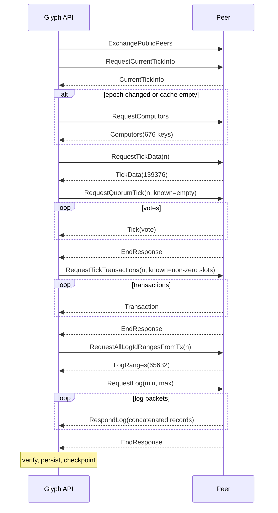

# Protocol

This document records the subset of the Qubic peer protocol that Glyph API uses, the exact
on-wire layouts, the request sequence, and the traps that cost time. All integers are
little-endian unless stated otherwise. The canonical decoders are in
[`crates/qubic/src/wire.rs`](../crates/qubic/src/wire.rs),
[`crates/qubic/src/messages.rs`](../crates/qubic/src/messages.rs),
[`crates/qubic/src/logs.rs`](../crates/qubic/src/logs.rs), and
[`crates/qubic/src/identity.rs`](../crates/qubic/src/identity.rs).

## Transport

- Direct TCP to a Qubic peer. Qubic core peers listen on `21841`. Bob peers listen on
  `21842`. There is no HTTP, WebSocket, or hosted RPC hop.
- One TCP connection is a stream of length-prefixed packets. There is no TLS and no
  authentication in the base protocol.
- Glyph API is a client only. It dials configured seeds and peers learned from
  `ExchangePublicPeers`. It never accepts inbound peer connections.
- A connection is single-writer and request/response is serialized per connection. Use
  one in-flight request per connection and a monotonically increasing `dejavu` value.
  Parallelism comes from multiple connections, not from pipelining on one socket.

## Framing

Every packet has an 8-byte header followed by a payload. The size field is 24 bits and
includes the header.

| Offset | Size | Field | Meaning |
| --- | --- | --- | --- |
| 0 | 3 | `size` | Total packet size in bytes, including the header. `u24` little-endian |
| 3 | 1 | `type` | Message type, see the table below |
| 4 | 4 | `dejavu` | Correlation id. The response echoes the request value |
| 8 | `size - 8` | `payload` | Type-specific body |

```text
 0        2 3        4                          8
 +----------+----------+--------------------------+----------------------+
 | size low | size mid | size high | type (u8)   | dejavu (u32 LE)      |  header
 +----------+----------+------------+-------------+----------------------+
 | payload (size - 8 bytes)                                             |
 +----------------------------------------------------------------------+
```

The Rust `Header::encode` writes `size.to_le_bytes()[0..3]`, then the type byte, then
`dejavu.to_le_bytes()`. `Header::decode` reads the first three bytes, rejects sizes below
8, and rejects unknown types. `MAX_PAYLOAD_SIZE` is `0x00FF_FFFF - 8`, or 16,777,207
bytes.

A stream reader must:

1. Read exactly 8 bytes for the header.
2. Validate `size >= 8` and `size <= 0x00FF_FFFF`.
3. Read exactly `size - 8` payload bytes.
4. Reject a packet whose type or `dejavu` does not match the outstanding request, unless
   it is a broadcast or an unsolicited notification.

## Message types

The values are the `u8` on the wire. `MessageType::from_u8` in
[`crates/qubic/src/wire.rs`](../crates/qubic/src/wire.rs) is authoritative.

| Value | Name | Direction | Used by Glyph API |
| --- | --- | --- | --- |
| 0 | `ExchangePublicPeers` | both | Yes, handshake and discovery |
| 1 | `BroadcastMessage` | peer to peer | No |
| 2 | `BroadcastComputors` | peer to peer | Observe only |
| 3 | `BroadcastTick` | peer to peer | Observe only, never authoritative |
| 8 | `BroadcastFutureTickData` | peer to peer | No |
| 11 | `RequestComputors` | client to peer | Yes, per epoch |
| 14 | `RequestQuorumTick` | client to peer | Yes, votes |
| 16 | `RequestTickData` | client to peer | Yes |
| 24 | `BroadcastTransaction` | both | Yes for opt-in broadcast; the indexer never broadcasts |
| 26 | `RequestTransactionInfo` | client to peer | Yes, peer transaction lookup |
| 27 | `RequestCurrentTickInfo` | client to peer | Yes |
| 28 | `RespondCurrentTickInfo` | peer to client | Yes |
| 29 | `RequestTickTransactions` | client to peer | Yes |
| 31 | `RequestEntity` | client to peer | Yes, entity lookup |
| 32 | `RespondEntity` | peer to client | Yes |
| 33 | `RequestContractIpo` | client to peer | No |
| 34 | `RespondContractIpo` | peer to client | No |
| 35 | `EndResponse` | peer to client | Yes, terminates a multi-packet response |
| 36 | `RequestIssuedAssets` | client to peer | Yes, issued-asset lookup |
| 37 | `RespondIssuedAssets` | peer to client | Yes |
| 38 | `RequestOwnedAssets` | client to peer | Yes, owned-asset lookup |
| 39 | `RespondOwnedAssets` | peer to client | Yes |
| 40 | `RequestPossessedAssets` | client to peer | Yes, possessed-asset lookup |
| 41 | `RespondPossessedAssets` | peer to client | Yes |
| 42 | `RequestContractFunction` | client to peer | Yes, read-only contract queries |
| 43 | `RespondContractFunction` | peer to client | Yes |
| 44 | `RequestLog` | client to peer | Yes |
| 45 | `RespondLog` | peer to client | Yes |
| 46 | `RequestSystemInfo` | client to peer | No |
| 47 | `RespondSystemInfo` | peer to client | No |
| 48 | `RequestLogIdRangeFromTx` | client to peer | Planned |
| 49 | `RespondLogIdRangeFromTx` | peer to client | Planned |
| 50 | `RequestAllLogIdRangesFromTx` | client to peer | Yes |
| 51 | `RespondAllLogIdRangesFromTx` | peer to client | Yes |
| 52 | `RequestAssets` | client to peer | Yes, filtered asset lookup |
| 53 | `RespondAssets` | peer to client | Yes |
| 54 | `TryAgain` | peer to client | Yes, back off |
| 56 | `RequestPruningLog` | client to peer | No |
| 57 | `RespondPruningLog` | peer to client | No |
| 58 | `RequestLogStateDigest` | client to peer | Planned |
| 59 | `RespondLogStateDigest` | peer to client | Planned |
| 64 | `RequestActiveIpos` | client to peer | No |
| 65 | `RespondActiveIpo` | peer to client | No |
| 66 | `RequestOracleData` | client to peer | No |
| 67 | `RespondOracleData` | peer to client | No |
| 70 | `RequestRevenueData` | client to peer | No |
| 71 | `RespondRevenueData` | peer to client | No |
| 78 | `RequestPriceSeries` | client to peer | Yes, BTC price series |
| 79 | `RespondPriceSeries` | peer to client | Yes |
| 255 | `SpecialCommand` | both | No |

`EndResponse` is a complete packet with the same `dejavu` as the request and an empty
payload. It means the peer has finished sending the response. It does not always mean the
response was empty. For `RequestLog`, `EndResponse` is the normal way to say "no records
in this range". For `RequestTickTransactions`, an immediate `EndResponse` means zero
transactions. The caller must retain the records already received.

`TryAgain` means the peer cannot serve the request now. Back off and retry, preferably on
a different peer. Do not treat it as an empty result.

## Handshake

```mermaid
sequenceDiagram
    participant G as Glyph API
    participant P as Qubic peer

    G->>P: TCP connect
    G->>P: ExchangePublicPeers(dejavu=1, [ip; 4])
    P-->>G: ExchangePublicPeers(dejavu=1, [ip; 4])
    G->>P: RequestCurrentTickInfo(dejavu=2)
    P-->>G: RespondCurrentTickInfo(dejavu=2)
    Note over G: peer scored, peer list merged
```

The `ExchangePublicPeers` payload is four IPv4 addresses, four bytes each, for 16 bytes
total. A zero address is ignored. The reply is a peer list, not an acknowledgement. Merge
the addresses into a bounded candidate set, deduplicate them, and dial only addresses that
are not already connected. There is no port in the payload, so discovered peers use the
default peer port.

The handshake is also the liveness probe. Measure connect latency and time to
`RespondCurrentTickInfo`. A peer that connects but does not answer within the timeout is
demoted.

## Message layouts

### `CurrentTickInfo` (16 bytes)

| Offset | Type | Field |
| --- | --- | --- |
| 0 | `u16` | `tick_duration`, in milliseconds |
| 2 | `u16` | `epoch` |
| 4 | `u32` | `tick`, the current network head |
| 8 | `u16` | `aligned_votes` |
| 10 | `u16` | `misaligned_votes` |
| 12 | `u32` | `initial_tick`, the first tick of the current epoch |

`RequestCurrentTickInfo` has an empty payload. The response is exactly 16 bytes.

### `Computors` (21,698 bytes)

| Offset | Type | Field |
| --- | --- | --- |
| 0 | `u16` | `epoch` |
| 2 | `[u8; 32] * 676` | `public_keys`, in computor index order |
| 21,634 | `[u8; 64]` | `signature` |

`COMPUTOR_COUNT = 676`. The epoch computor set is cached for the whole epoch. The
signature covers the signable computor bytes. Verify it before trusting the key list. A
vote signed by a key that is not in this list is discarded.

### `Tick` (352 bytes)

A tick is both a proposal and a vote. Quorum responses are a sequence of `Tick` packets,
one per computor, followed by `EndResponse`.

| Offset | Type | Field |
| --- | --- | --- |
| 0 | `u16` | `computor_index` |
| 2 | `u16` | `epoch` |
| 4 | `u32` | `tick` |
| 8 | `u16` | `millisecond` |
| 10 | `u8` | `second` |
| 11 | `u8` | `minute` |
| 12 | `u8` | `hour` |
| 13 | `u8` | `day` |
| 14 | `u8` | `month` |
| 15 | `u8` | `year`, offset from 2000 |
| 16 | `u32` | `prev_resource_testing_digest` |
| 20 | `u32` | `salted_resource_testing_digest` |
| 24 | `u32` | `prev_transaction_body_digest` |
| 28 | `u32` | `salted_transaction_body_digest` |
| 32 | `[u8; 32]` | `prev_spectrum_digest` |
| 64 | `[u8; 32]` | `prev_universe_digest` |
| 96 | `[u8; 32]` | `prev_computer_digest` |
| 128 | `[u8; 32]` | `salted_spectrum_digest` |
| 160 | `[u8; 32]` | `salted_universe_digest` |
| 192 | `[u8; 32]` | `salted_computer_digest` |
| 224 | `[u8; 32]` | `transaction_digest` |
| 256 | `[u8; 32]` | `expected_next_tick_transaction_digest` |
| 288 | `[u8; 64]` | `signature` |

The signature preimage is the 288-byte header before the signature field. The signature
field itself is never part of the preimage. `Tick::digest` in the crate is the helper used
for candidate identity and fork detection. It is not the signature preimage if it includes
the signature field, so do not substitute one for the other.

An empty tick has `transaction_digest == [0u8; 32]` and no non-zero transaction slots.
Empty ticks still have a quorum, but the threshold is lower.

### `TickData` (139,376 bytes)

| Offset | Type | Field |
| --- | --- | --- |
| 0 | `u16` | `computor_index` |
| 2 | `u16` | `epoch` |
| 4 | `u32` | `tick` |
| 8 | `u16` | `millisecond` |
| 10 | `u8` | `second` |
| 11 | `u8` | `minute` |
| 12 | `u8` | `hour` |
| 13 | `u8` | `day` |
| 14 | `u8` | `month` |
| 15 | `u8` | `year` |
| 16 | `[u8; 32]` | `timelock` |
| 48 | `[u8; 32] * 4096` | `transaction_digests`, zero-filled slots included |
| 131,120 | `i64 * 1024` | `contract_fees` |
| 139,312 | `[u8; 64]` | `signature` |

`TX_PER_TICK = 4096`, `MAX_CONTRACTS = 1024`. The transaction digest array always contains
4,096 entries. A slot with an all-zero digest is empty. Never infer the transaction count
from the packet length. Count non-zero digests.

The signature preimage is the first 139,312 bytes. The header fields must match the
corresponding `Tick` fields byte for byte. The tick's `transaction_digest` is the
commitment to this transaction set. The verifier checks it with the helpers in the crate.
Do not compare it to a naive hash of just the digest array, because the commitment also
covers fees and the header.

### `Transaction` (variable)

| Offset | Type | Field |
| --- | --- | --- |
| 0 | `[u8; 32]` | `source` |
| 32 | `[u8; 32]` | `destination` |
| 64 | `i64` | `amount` |
| 72 | `u32` | `tick` |
| 76 | `u16` | `input_type` |
| 78 | `u16` | `input_size` |
| 80 | `[u8; input_size]` | `input` |
| 80 + `input_size` | `[u8; 64]` | `signature` |

`BASE_SIZE = 80`, maximum input is 1,024 bytes, and the total size is exactly
`80 + input_size + 64`. A payload whose length does not match is a decode error. The
signature preimage is the first `80 + input_size` bytes. The transaction hash is
`K12(full signed bytes)`, including the signature, and is rendered as a 60-character
lowercase base-26 string.

`input_size` is a `u16` on the wire but the protocol limit is 1,024. Reject larger values
before allocation.

### `AssetRecord` (48 bytes)

Asset responses share a 48-byte tagged record. The remaining 16 bytes are interpreted by
`record_type`; keep all 48 bytes when re-encoding an unknown type.

| Offset | Type | Field |
| --- | --- | --- |
| 0 | `[u8; 32]` | `public_key`, the issuer, owner, or possessor |
| 32 | `u8` | `record_type`: `0` empty, `1` issuance, `2` ownership, `3` possession |
| 33 | `[u8; 7]` | issuance only: `name` |
| 40 | `u8` | issuance only: `decimals` |
| 41 | `[u8; 7]` | issuance only: `unit`, SI powers stored as bytes offset by 48 |
| 34 | `u16` | ownership/possession: `managing_contract_index` |
| 36 | `u32` | ownership: `issuance_index`; possession: `ownership_index` |
| 40 | `i64` | ownership/possession: `shares` |

Offset 33 is padding for ownership and possession records. An empty record has no payload
beyond `record_type` and a zeroed remainder. The asset name is ASCII, at most seven bytes,
and is decoded by stopping at the first zero. The unit is not trimmed: all seven bytes are
meaningful SI exponents, and a zero byte renders as the digit `0`.

### Asset requests and responses

`RequestIssuedAssets`, `RequestOwnedAssets`, and `RequestPossessedAssets` each carry one
32-byte public key. A peer streams every matching record as a separate response packet and
terminates the stream with `EndResponse`. A peer with no matches sends `EndResponse`
immediately. There is no count field; keep reading until `EndResponse`.

| Response | Size | Layout |
| --- | --- | --- |
| `RespondIssuedAssets` | 824 | `asset`, `u32 tick`, `u32 universe_index`, 24 sibling digests |
| `RespondOwnedAssets` | 872 | `asset`, `issuance_asset`, `u32 tick`, `u32 universe_index`, 24 siblings |
| `RespondPossessedAssets` | 920 | `asset`, `ownership_asset`, `issuance_asset`, `u32 tick`, `u32 universe_index`, 24 siblings |

`RequestAssets` adds server-side filtering. Its 112-byte filter form is:

| Offset | Type | Field |
| --- | --- | --- |
| 0 | `u16` | `asset_request_type`: `0` issuance, `1` ownership, `2` possession, `3` by universe index |
| 2 | `u16` | `flags` |
| 4 | `u16` | `ownership_managing_contract` |
| 6 | `u16` | `possession_managing_contract` |
| 8 | `[u8; 32]` | `issuer` |
| 40 | `u64` | `asset_name`, packed eight-byte name |
| 48 | `[u8; 32]` | `owner` |
| 80 | `[u8; 32]` | `possessor` |

For `asset_request_type = 3`, only the first eight bytes are meaningful: `u16` type,
`u16` flags, `u32 universe_index`. A core accepts that eight-byte payload even though the
filter form is 112 bytes.

Flags are: `0b1` include Merkle siblings, `0b10` any issuer, `0b100` any asset name,
`0b1000` any owner, `0b10000` any ownership managing contract, `0b100000` any possessor,
`0b1000000` any possession managing contract. Unset filter fields must match exactly.

Without the siblings flag the response is a 56-byte `RespondAssets`: `asset`, `u32 tick`,
`u32 universe_index`. With the flag it is an 824-byte `RespondAssetsWithSiblings`: the same
56-byte prefix followed by 24 sibling digests. A single `RequestAssets` can produce many
response packets, terminated by `EndResponse`.

### `RequestPriceSeries` (8 bytes) and `RespondPriceSeries` (variable)

The price series is the node's hourly BTC/USDT feed. `RequestPriceSeries` carries
`u32 from_hour` and `u32 count`. A core clamps `count` to 256
(`PRICE_SERIES_MAX_POINTS_PER_RESPONSE`).

The response starts with a 124-byte header:

| Offset | Type | Field |
| --- | --- | --- |
| 0 | `u32` | `tick` at response time |
| 4 | `u16` | `epoch` |
| 6 | `u8` | `synced`, `1` when the series is usable |
| 7 | `u8` | `bound`, `1` while an oracle query is bound |
| 8 | `u32` | `source`: `1` bootstrap, `2` epoch switch, `3` F6, `4` snapshot |
| 12 | `u32` | `next_hour`, the first hour not yet appended |
| 16 | `u32` | `failed_attempts` for `next_hour` |
| 20 | `i64` | `first_fail_ms` |
| 28 | `i64` | `last_fail_ms` |
| 36 | `[u8; 32]` | `series_digest` |
| 68 | `u64` | `num_success` |
| 76 | `u64` | `num_timeout` |
| 84 | `u64` | `num_unresolvable` |
| 92 | `u64` | `num_invalid_reply` |
| 100 | `u64` | `num_start_failed` |
| 108 | `u64` | `num_filled` |
| 116 | `u32` | `base_hour`, the last hour known when the epoch began |
| 120 | `u32` | `count`, number of points that follow |

Each point is 20 bytes: `u32 hour`, `u32 append_tick`, `u32 flags`, `i64 price_e8`.
`price_e8` is the whole-USDT price scaled by `1e8`. Bit `0` of `flags`
(`BTC_PRICE_FLAG_FILLED`) marks an hour whose price was filled from the previous hour after
the feed gave up. The payload is exactly `124 + count * 20` bytes: a node omits hours it
does not hold, so `count` can be less than the requested count and a point's `hour` can
skip ahead.

`base_hour` anchors the epoch task window. For target `t` of an epoch, the relevant hour is
`base_hour - 8759 + t`; hours before `base_hour` are fixed for that epoch. Never assume
`from_hour + i == points[i].hour`.

### `LogRanges` (65,632 bytes)

| Offset | Type | Field |
| --- | --- | --- |
| 0 | `i64 * 4102` | `from_log_id` |
| 32,816 | `i64 * 4102` | `length` |

`LOG_TX_PER_TICK = 4096 + 6 = 4102`. Indices `0..4095` correspond to the transaction slot
with the same index. Indices `4096..4101` are the six special event slots that are not
attached to a transaction. A valid range is `from_log_id >= 0` and `length >= 0`. The
range is inclusive, covering `[from, from + length - 1]`. A `length` of zero means no logs
for that slot.

`-3` marks a range that is still pending. The tick is not ready for log indexing. Wait and
re-request the full ranges. Do not persist a partial log set for a pending tick.

### `LogEvent` (variable, 26-byte header)

A `RespondLog` packet contains one or more concatenated records with no padding between
records. There is no count field. Walk the buffer using `size` until it is exhausted.

| Offset | Type | Field |
| --- | --- | --- |
| 0 | `u16` | `epoch` |
| 2 | `u32` | `tick` |
| 6 | `u32` | `combo`: `size` in bits 0..23, `log_type` in bits 24..31 |
| 10 | `u64` | `log_id` |
| 18 | `u64` | `log_digest` |
| 26 | `[u8; size]` | `body` |

`LOG_HEADER_SIZE = 26`. The digest is `K12_8(body)` read as a little-endian `u64`. A
record whose declared body size would exceed the packet is an error for the whole packet,
because the next record boundary is unknown.

Log IDs are scoped to the epoch. The same numeric `log_id` in epoch 241 is a different
event. The API's canonical event ID is `{epoch}:{log_id}`.

### Log bodies

The body offsets below are implemented in
[`crates/qubic/src/logs.rs`](../crates/qubic/src/logs.rs). Values larger than the body are
rejected as malformed or decoded as `unknown`.

| Type | Name | Minimum body | Layout |
| --- | --- | --- | --- |
| 0 | `qu_transfer` | 72 | `from[32]`, `to[32]`, `amount i64` |
| 1 | `asset_issuance` | 63 | `issuer[32]`, `shares i64`, `managing_contract i64`, `name[7]`, `decimals u8`, `unit[7]` |
| 2 | `asset_ownership_change` | 119 | `from[32]`, `to[32]`, `issuer[32]`, `shares i64`, `managing_contract i64`, `name[7]`, `decimals u8`, `unit[7]` |
| 3 | `asset_possession_change` | 119 | Same as type 2 |
| 4 | `contract_error_message` | 8 | `contract_index u32`, `message_type u32`, `data` |
| 5 | `contract_warning_message` | 8 | Same as type 4 |
| 6 | `contract_information_message` | 8 | Same as type 4 |
| 7 | `contract_debug_message` | 8 | Same as type 4 |
| 8 | `burning` | 44 | `from[32]`, `amount i64`, `contract_index u32` |
| 9 | `dust_burning` | 2 | `count u16`, then `count` pairs of `identity[32]` and `amount i64` |
| 10 | `spectrum_stats` | 0 | Opaque |
| 11 | `asset_ownership_managing_contract_change` | 0 | Opaque until typed |
| 12 | `asset_possession_managing_contract_change` | 0 | Opaque until typed |
| 13 | `contract_reserve_deduction` | 0 | Opaque until typed |
| 14 | `oracle_query_status_change` | 0 | Opaque until typed |
| 15 | `oracle_subscriber_message` | 0 | Opaque until typed |
| 16 | `oc_invocation_status_change` | 0 | Opaque until typed |
| 255 | `custom_message` | 8 | `op_code u64`, `data` |

Asset names and unit strings are 7 bytes, null terminated and space padded in practice.
Decode them as ASCII and trim trailing nulls and spaces. Do not assume UTF-8.

Recognized custom op codes:

| Constant | Value |
| --- | --- |
| `CUSTOM_OP_START_DISTRIBUTE_DIVIDENDS` | `6217575821008262227` |
| `CUSTOM_OP_END_DISTRIBUTE_DIVIDENDS` | `6217575821008457285` |
| `CUSTOM_OP_START_EPOCH` | `4850183582582395987` |
| `CUSTOM_OP_END_EPOCH` | `4850183582582591045` |

The `END_EPOCH` custom event is the signal used to synthesize the virtual end-epoch tick.
It is not a normal transaction and does not have a transaction slot.

### Price series (variable)

`RespondPriceSeries` starts with a 124-byte header followed by `count` 20-byte points.
The payload is exactly `124 + count * 20` bytes; a peer omits hours it does not hold and
sets `count` to the number of points actually present.

| Offset | Type | Field |
| --- | --- | --- |
| 0 | `u32` | `tick`, the peer's current tick |
| 4 | `u16` | `epoch` |
| 6 | `u8` | `synced`, 1 when the peer holds a usable series |
| 7 | `u8` | `bound`, 1 while a query for `next_hour` is running |
| 8 | `u32` | `source`, 1 bootstrap, 2 epoch switch, 3 F6, 4 snapshot |
| 12 | `u32` | `next_hour`, first hour not stored yet |
| 16 | `u32` | `failed_attempts` for `next_hour` |
| 20 | `i64` | `first_fail_ms` |
| 28 | `i64` | `last_fail_ms` |
| 36 | `[u8; 32]` | `series_digest` |
| 68 | `u64` | `num_success` |
| 76 | `u64` | `num_timeout` |
| 84 | `u64` | `num_unresolvable` |
| 92 | `u64` | `num_invalid_reply` |
| 100 | `u64` | `num_start_failed` |
| 108 | `u64` | `num_filled` |
| 116 | `u32` | `base_hour`, last hour known when the epoch began |
| 120 | `u32` | `count`, points that follow |
| 124 | point * `count` | points |

Each point is `u32 hour`, `u32 append_tick`, `u32 flags`, `i64 price_e8`. Flag bit 0 marks
an hour filled with the previous hour's price. `price_e8` is the price in 0.00000001 USDT.
Hours are counted from 2022-04-13 12:00:00 UTC. A peer returns at most 256 points per
response, so request a larger range in pages.

`RequestPriceSeries` is `u32 from_hour`, `u32 count`. A count above 256 is clamped by the
peer. Hours before `from_hour` are never included.

## Request payloads

| Request | Payload | Total |
| --- | --- | --- |
| `RequestCurrentTickInfo` | empty | 0 |
| `RequestComputors` | empty | 0 |
| `RequestTickData` | `u32 tick` | 4 |
| `RequestQuorumTick` | `u32 tick`, 85-byte known-vote bitmap, 3 bytes padding | 92 |
| `RequestTickTransactions` | `u32 tick`, 512-byte known-tx bitmap | 516 |
| `RequestAllLogIdRangesFromTx` | passcode `[u64; 4]`, `u32 tick` | 36 |
| `RequestLog` | passcode `[u64; 4]`, `u64 from_log_id`, `u64 to_log_id` | 48 |
| `RequestPriceSeries` | `u32 from_hour`, `u32 count` | 8 |
| `RequestIssuedAssets`, `RequestOwnedAssets`, `RequestPossessedAssets` | `[u8; 32] public_key` | 32 |
| `RequestAssets` | `u16 request_type`, `u16 flags`, type-specific filter fields | 8 or 112 |
| `ExchangePublicPeers` | four `[u8; 4]` IPv4 addresses | 16 |

The known-vote and known-transaction bitmaps let the client ask only for entries it does
not have. Bit `i` is set when the client already has item `i`. On the first request for a
tick, send all zeros. On a retry, set the votes or transactions already collected. The
bitmap is indexed by computor index for votes and by transaction slot for transactions.
Bit order within each byte is least-significant bit first, matching
`flags[index / 8] |= 1 << (index % 8)`.

`RequestQuorumTick` is 92 bytes, not 89. The three padding bytes after the 85-byte bitmap
are part of the wire layout.

`RequestAllLogIdRangesFromTx` takes the passcode first, then the tick. `RequestLog` takes
the passcode first, then the inclusive log ID range. A passcode of `[0; 4]` selects public
data. Do not invent passcodes.

## Ingestion sequence



The exact order is not mandated by the protocol. Glyph API uses this order because it fails
fast on the cheapest checks first and lets a tick be rejected before the expensive log
fetch.

Steps:

1. **Head.** `RequestCurrentTickInfo` gives `epoch`, `tick`, `initial_tick`, and
   `tick_duration`. If `tick` is below the local head, the peer is stale. If
   `initial_tick` differs from the cached value for this epoch, drop the cache and start
   over at the new initial tick. This is the epoch rollover signal.
2. **Computors.** Fetch once per epoch. Verify the computor set signature. Cache the key
   array by index.
3. **Tick data.** `RequestTickData(n)`. A peer that has not synchronized to `n` may return
   `TryAgain`, `EndResponse`, or an error. Retry another peer. Do not request a tick above
   the peer's advertised head.
4. **Votes.** `RequestQuorumTick(n, known)`. Collect `Tick` packets until `EndResponse`.
   Deduplicate by `computor_index`. Verify each signature against the epoch key at that
   index. Drop invalid votes. Count aligned votes that match the candidate tick fields.
5. **Transactions.** Build the known bitmap from the non-zero slots in `TickData`. Send
   `RequestTickTransactions(n, known)`. Collect `Transaction` packets until
   `EndResponse`. Compute each hash and match it to the slot. A missing or extra
   transaction fails the data tier.
6. **Log ranges.** Send `RequestAllLogIdRangesFromTx(n)` with a zero passcode. The
   response is exactly 65,632 bytes. If any slot is `-3`, wait and retry. Otherwise
   compute the minimum `from` and maximum `from + length - 1` across valid slots. If no
   slot has logs, the tick has no events and the log fetch is complete.
7. **Logs.** `RequestLog(from, to)` can return at most one packet, and a packet is at most
   16,777,215 bytes including the header. Split large ranges into chunks that fit. Decode
   all records, verify each digest, and map each `log_id` back to the slot using the
   ranges. A log record outside every range is a data-tier failure.
8. **Verify.** Apply the tiers in [ARCHITECTURE.md](./ARCHITECTURE.md#verification-tiers).
9. **Persist and checkpoint.** Write the tick, transactions, events, and aggregate deltas
   with a single `version`, then advance the checkpoint. Never advance the checkpoint
   before the rows are durable.

## Quorum rules

- There are 676 computors per epoch.
- A non-empty tick requires at least **451** aligned valid votes.
- An empty tick requires at least **226** aligned valid votes.
- One vote per computor index. Duplicate packets from the same computor count once.
- A vote is aligned when its tick fields and transaction commitment match the candidate
  tick. A valid signature over a different tick is a misaligned vote, not a vote for the
  candidate.
- A vote from a key outside the epoch computor set is discarded.
- The threshold is a floor. Collecting more votes is useful for the audit record but does
  not change the canonical tick.
- If the threshold is not reached by the deadline, do not persist. Retry with a longer
  deadline and more peers. If two different candidates each reach threshold, stop and
  quarantine the tick. This should not happen in a healthy network and indicates a peer
  problem or a protocol change.

`CurrentTickInfo.aligned_votes` and `misaligned_votes` are peer observations, not proof.
They are a hint for how long to wait. The verifier counts signatures itself.

## Logs

- Log IDs are per epoch and assigned by the network. They are not transaction hashes and
  they are not globally unique across epochs.
- `RequestLog` returns concatenated records in one packet. A large range can exceed the
  packet limit, so request ranges in chunks.
- `END_RESPONSE` with no prior records means there are no logs in the requested range. It
  does not mean the range is invalid or that the peer is broken.
- The six special slots in `LogRanges` are indices 4096 to 4101. They correspond to system
  events such as epoch transitions. They have no transaction hash.
- A transaction can emit multiple log records. The range length gives the count. Log IDs
  within a transaction's range are contiguous.
- The log digest is over the body only, not over the header. The header is covered by the
  tick commitment and by the range mapping.
- Private contract logs require a passcode. Glyph API only indexes public data unless an
  operator explicitly configures a passcode for a contract it is allowed to read.

## End-epoch virtual tick

The protocol carries an `END_EPOCH` custom log event at the boundary. A separate synthetic
tick for that boundary is planned but is not currently created. The indexer stores the
`END_EPOCH` event with its normal log row on the boundary tick and advances to the next
epoch `initial_tick` when `CurrentTickInfo` changes.

If implemented, the virtual tick would have these properties:

Properties:

- `kind = "epochEnd"`.
- `epoch` is the ending epoch.
- `tick` is the boundary tick. If the next epoch `initial_tick` is known, use it. Otherwise
  use `initial_tick + 604_800`.
- `transaction_count = 0` for normal transactions. The end-epoch event is stored as an
  event on this tick with `tx_index = -1`.
- Verification would be inherited from the last verified normal tick; the `state` tier is
  reserved and not emitted today.
- The next epoch's first normal tick is `initial_tick` of the new epoch. It is never
  merged with the virtual tick.

Do not query peers for the virtual tick. A peer will return `EndResponse` or an error, and
treating that as a missing tick will stall the indexer at every epoch boundary.

## Epoch handling

- Epoch length is 7 days at 1 tick per second: 604,800 ticks.
- `initial_tick` is reported by the peer. Do not compute it from wall time.
- Epochs before 240 are out of scope. There is no backfill path and no compatibility
  reader for older layouts.
- Log IDs and computor keys reset at the epoch boundary. Caches and cursors must be keyed
  by epoch.
- If the indexer starts mid-epoch, it starts at the current epoch `initial_tick` and
  catches up. It never starts in the middle and claims the earlier ticks exist.
- If the peer's retention no longer covers `initial_tick`, wait for the next epoch. Do not
  jump forward and publish a partial epoch.

## Identity and hash encoding

A 32-byte key is rendered as 60 characters:

- Split the key into four 8-byte little-endian fragments.
- Render each fragment as 14 base-26 digits, least-significant digit first.
- Use `A-Z` for identities and `a-z` for transaction hashes.
- Append four checksum characters. The checksum is derived from `K12_32(key)`, taking the
  first three digest bytes as a little-endian `u32`, masking with `0x3FFFF`, and rendering
  four base-26 digits.
- Decoding checks length 60, validates the alphabet, decodes the first 56 characters, and
  recomputes the checksum. Non-canonical input is rejected.

Examples:

- Identity: `BZBQFLLBNCXEMGLOBHUVFTLUPLVCPQUASSILFABOFFBCADQSSUPNWLZBQEXK`
- Transaction hash: lowercase form of the same encoding over the hash bytes.

The API accepts `0x` plus 64 hex characters as a debug input and normalizes to the
canonical base-26 form in responses. The wire never uses hex.

## Gotchas

1. **The size field is 24 bits and includes the header.** Do not read a `u32` and do not
   add 8 twice.
2. **The type byte is at offset 3.** It is not part of the little-endian size. Reading a
   `u32` size and masking incorrectly shifts the type into the size.
3. **`dejavu` is a correlation id, not a version.** Echo it and match it. Do not reuse a
   value for concurrent requests on the same connection.
4. **Broadcasts are interleaved.** A `BroadcastTick` or `BroadcastTransaction` can arrive
   while a request is outstanding. Skip it and keep reading for the expected type and
   `dejavu`. Do not treat it as the response.
5. **`EndResponse` is a valid empty result.** For logs and transactions, it often means
   zero records, not failure.
6. **`TryAgain` is not empty.** It is a retry signal.
7. **TickData always has 4,096 digest slots.** Count non-zero entries. Do not divide the
   payload size by 32.
8. **LogRanges always has 4,102 slots.** The last six are special events.
9. **`-3` means pending.** A negative range is not "no logs". Retry.
10. **Log IDs are per epoch.** Never use a bare `log_id` as a global primary key.
11. **The tick header time has a year offset of 2000.** A `year` of 26 means 2026.
12. **Timestamps are not monotonic across peers.** Use the tick number for ordering and
    the header time for display. If two peers disagree on time for the same tick, the
    quorum tick wins.
13. **The maximum input is 1,024 bytes even though `input_size` is `u16`.** Reject larger
    values before allocating.
14. **A transaction's size is exact.** `80 + input_size + 64` must equal the packet
    payload length.
15. **The transaction hash includes the signature.** Hashing only the unsigned fields
    produces the wrong hash.
16. **Votes can arrive late.** A peer may return fewer than 676 votes, or may return votes
    after a timeout. Collect until `EndResponse` or the deadline. Do not count a partial
    response as a failure immediately.
17. **A peer's head can move backwards after a restart.** Compare with the local head and
    demote the peer. Never roll back a quorum-verified tick.
18. **Do not request the virtual end-epoch tick.** It has no `TickData`.
19. **Log packet size is bounded.** A single `RespondLog` cannot exceed 16,777,215 bytes.
    Split ranges.
20. **The `END_EPOCH` op code is not the end-epoch tick number.** It is a custom message
    payload that signals the transition. Derive the tick from the epoch boundary.

## Compatibility

The wire protocol is defined by the Qubic network, not by Glyph API. If a peer returns a
message whose fixed size does not match these layouts, mark the peer incompatible and move
on. Do not guess, pad, or truncate. A wire change requires a new decoder and a new
capability check, not a silent fallback.
